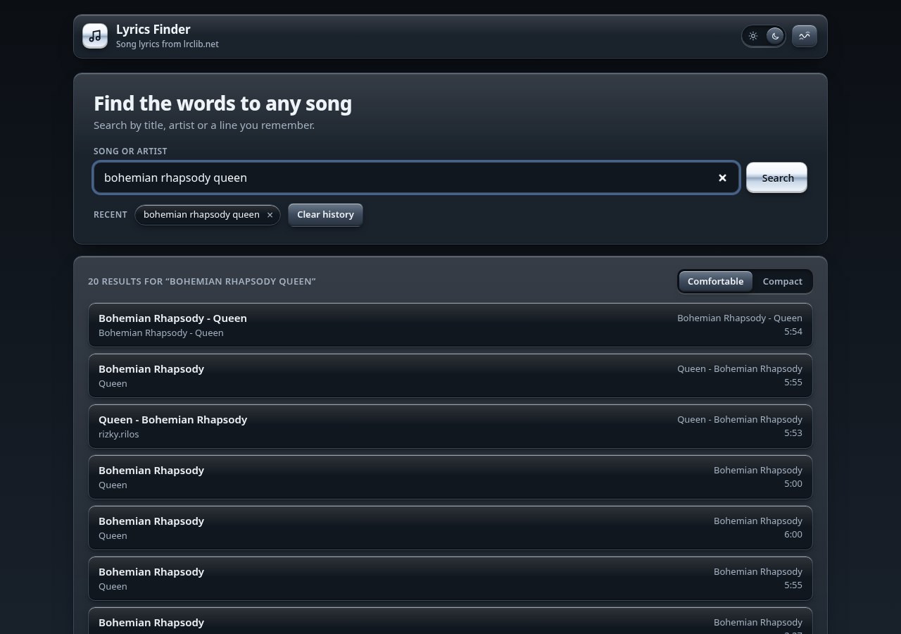
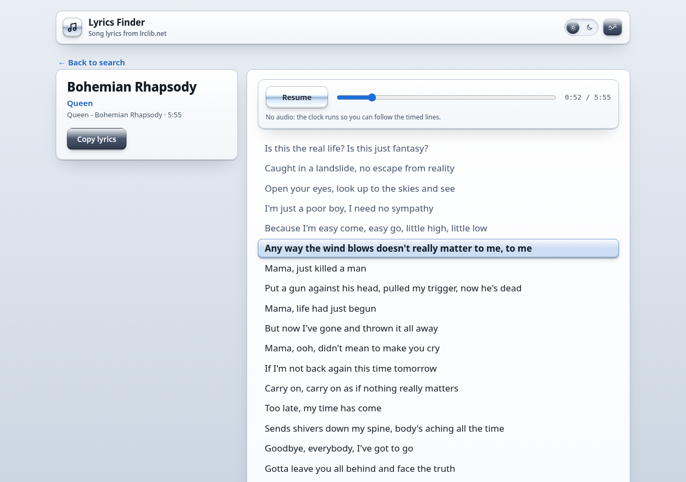

# Lyrics Finder

Search song lyrics from [lrclib.net](https://lrclib.net). No account and no API key.

**Live:** https://ali1129js.github.io/lyricsfinder-app/





## What it does

- Search by title, artist or a remembered line. Typing pauses for 350 ms before searching, and a new search aborts the request still in flight.
- Recent searches (last 6, saved in the browser, checked with Zod) as chips you can reach with Tab, remove one by one or clear. A Compact switch shows one line per result.
- Open a result to read the lyrics, copy them in one click, or deep-link to `#/track/<id>`.
- Clear messages for "nothing matched", network trouble, server errors, instrumental tracks and tracks without lyrics.
- Chrome style (mirror metal) in light and dark. The wave button next to the switch turns on a slow sheen. It is off by default, and a system "reduce motion" setting always keeps it off.

## Stack

Vite, React 19, strict TypeScript, Zod (API and localStorage validation), Vitest with Testing Library.

```bash
npm install
npm run dev        # http://localhost:5173/lyricsfinder-app/
npm test
npm run typecheck
npm run build
```

## Deploy

GitHub Pages serves the `gh-pages` branch. `npm run deploy` runs typecheck, tests and the build, then publishes `dist/` to `gh-pages` with the [gh-pages](https://www.npmjs.com/package/gh-pages) package (a normal commit on that branch, not a force-push). CI runs the same checks on every push to `rebuild/ts-2026`.

## History

This is a 2026 rebuild. The original 2018/2019 Create React App (class components, Bootstrap, Context API) is kept on the `master` branch and tagged `legacy-cra-2019`. The CRA build that GitHub Pages served before the rebuild is tagged `legacy-cra-pages-2026-10`.

See [LEARN.md](LEARN.md) for the ideas behind the code.
